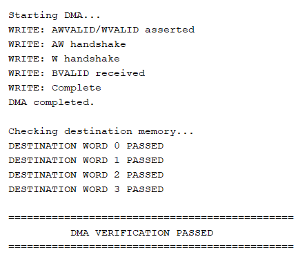
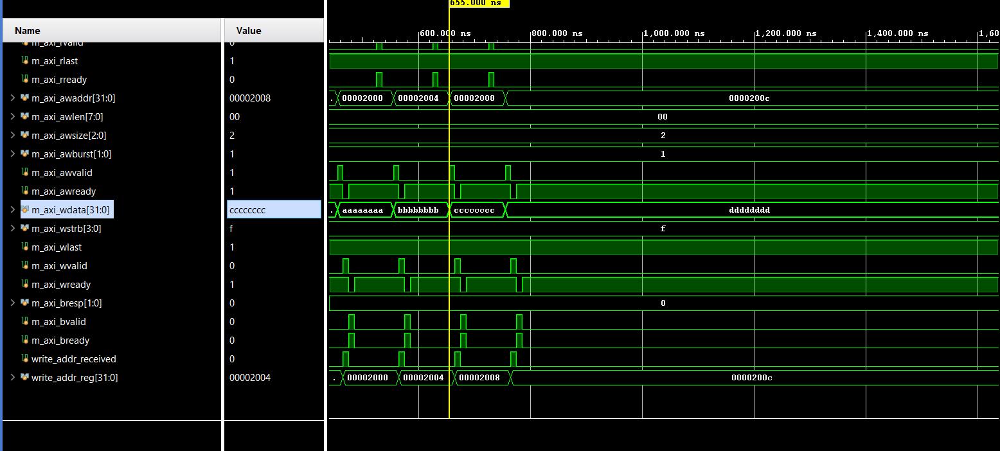

# AXI4-Lite Controlled DMA Controller

A modular SystemVerilog implementation of a programmable memory-to-memory DMA controller with an AXI4-Lite control interface and AXI4 memory-mapped data interface.

## Overview

This project implements a simple DMA controller that transfers data from a source memory address to a destination memory address.

The DMA controller is programmed through an AXI4-Lite slave interface and performs data movement through an AXI4 master interface.

The design was developed as an RTL design and verified using a self-checking SystemVerilog testbench and SystemVerilog Assertions (SVA).

## Architecture

The system consists of:

- AXI4-Lite slave interface
- DMA register bank
- DMA controller
- AXI4 read engine
- One-entry data buffer
- AXI4 write engine

High-level data flow:

```text
AXI4-Lite
   |
   v
Register Bank
   |
   v
DMA Controller
   |
   +----> AXI4 Read Engine
   |             |
   |             v
   |          Data Buffer
   |             |
   |             v
   +----> AXI4 Write Engine
                 |
                 v
             Destination
```

See [docs/architecture.md](docs/architecture.md) for the full architecture.

## Features

- AXI4-Lite programmable control interface
- AXI4 memory-mapped master interface
- Memory-to-memory data transfer
- 32-bit data width
- 4-byte word transfers
- Single-beat AXI transactions
- Incrementing address mode
- One-entry internal data buffer
- Configurable source address
- Configurable destination address
- Configurable transfer length
- Transfer status reporting
- Transfer count reporting
- Error reporting
- Self-checking simulation testbench
- SystemVerilog Assertions for protocol/design checks

## Register Map

| Address | Register | Description |
|---------|----------|-------------|
| 0x00 | CONTROL | Start control |
| 0x04 | STATUS | DMA status |
| 0x08 | SOURCE_ADDR | Source memory address |
| 0x0C | DEST_ADDR | Destination memory address |
| 0x10 | LENGTH | Transfer length |
| 0x14 | TRANSFER_COUNT | Number of transferred words |
| 0x18 | ERROR | Error status |

See [docs/register_map.md](docs/register_map.md) for field-level details.

## Verification

The design is verified using:

- Directed SystemVerilog testbench
- Self-checking destination-memory comparisons
- AXI memory model
- SystemVerilog Assertions

The basic verification scenario transfers four 32-bit words from a source region to a destination region and checks that all destination words match the source data.

This verification is directed and intentionally focused. It does not claim exhaustive protocol or functional coverage; see [docs/verification.md](docs/verification.md) for its scope and possible extensions.

## Simulation Results

Testbench console output showing all four destination words passing:



Waveform of the AXI write channel transferring the four words:



The start of the test log is in [results/dma_verification_passed.png.png](results/dma_verification_passed.png.png). Synthesis and timing results are not included yet.

## Design Notes

[docs/challenges.md](docs/challenges.md) describes the main design and debugging challenges.

## Tools

- SystemVerilog
- Xilinx Vivado
- XSim
- Git / GitHub

## Project Structure

```text
axi4-lite-dma-controller/
├── rtl/
├── tb/
├── sva/
├── docs/
├── results/
├── LICENSE
├── README.md
└── .gitignore
```

## License

Released under the [MIT License](LICENSE).